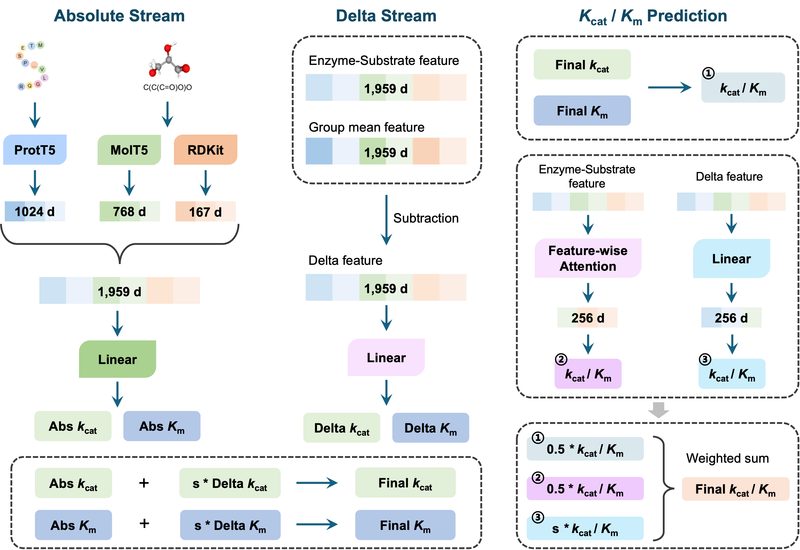

# CataPro-v2 — inference

**English** | [中文](README_zh.md)

CataPro-v2 is the **fine-tuned** version of [CataPro](https://github.com/zchwang/CataPro). It keeps
CataPro's frozen absolute prediction stream and adds a **trainable mutation-effect residual stream**
so that, for a set of mutants of the same enzyme/substrate pair, the model can order them by the
measured kinetic effect — while kcat, Km and kcat/Km still share **one identical architecture**.

Predicting enzyme kinetic parameters — turnover number (kcat), Michaelis constant (Km) and
catalytic efficiency (kcat/Km) — is central to enzyme discovery and engineering. CataPro-v2 was
built on the same unbiased 0.4-sequence-similarity 10-fold cross-validation datasets used by
CataPro (collected from BRENDA and SABIO-RK), but instead of training one head per fold it
fine-tunes a *target-centred* residual on top of the released per-fold base models.

For a batch of rows that share one (enzyme, substrate) group,

```
out = out_abs(x)  +  scale · delta(x − group_mean(x))
```

where `out_abs` is the frozen CataPro prediction (bit-for-bit at initialisation), `delta` is a
**bounded** mutation-effect term (`tanh`, so ∈ (−1, 1)) and `scale = delta_max · sigmoid(gate)`
(also bounded). A group with a single row has `delta = 0`, so the prediction falls back to the
released CataPro base model.



> **This repository contains the CataPro-v2 inference code and the canonical fine-tuned model
> weights only.** The fine-tuning pipeline (training code, hyper-parameters, cross-validation and
> the one-axis ablation variants) is not part of this release; only the models written up for
> CataPro-v2 — the `dual_residual_stabilized__composite_hinge` family — are shipped, and every
> weight needed to run inference is self-contained (the frozen absolute stream is stored inside
> each `model.pth`).

---

## 1. Create the CataPro-v2 environment

To run CataPro-v2 you should create a conda environment that includes the following packages:

```
pytorch >= 1.13.0
transformers
numpy
pandas
RDKit
```

In addition, CataPro-v2 relies on the same two pre-trained encoders as CataPro. They are used to
extract features from enzymes and substrates, respectively, and **you must download them yourself**
and place them under `models/`:

| model | purpose | place under |
|---|---|---|
| [prot_t5_xl_uniref50](https://huggingface.co/Rostlab/prot_t5_xl_uniref50) | enzyme sequence encoder (1024-d) | `models/prot_t5_xl_uniref50/` |
| [molt5-base-smiles2caption](https://huggingface.co/laituan245/molt5-base-smiles2caption) | substrate SMILES encoder (768-d) | `models/molt5-base-smiles2caption/` |

> `models/prot_t5_xl_uniref50` and `models/molt5-base-smiles2caption` are the **only** two entries
> that are not shipped as project files — download the weights from the links above and put them in
> place. Every other file in the repository is a real file, ready to run.

---

## 2. Repository layout

```
CataPro-v2/
  README.md                     # English (this file)
  README_zh.md                  # Chinese
  LICENSE
  models/
    fig1_architecture.png
    prot_t5_xl_uniref50/        # <- download (link above)
    molt5-base-smiles2caption/  # <- download (link above)
  samples/sample_inp.csv        # example inference input
  inference/
    predict_v2.py               # CataPro-v2 inference (fine-tuned delta models)
    utils.py                    # feature extraction (ProtT5 / MolT5 / MACCS)
  finetune/train/
    common/
      data.py                   # N_FEAT, group-mean delta context, predict_array
      model.py                  # DualStreamRegressor / ActivityModel definitions
      eval_model.py             # load_model_for_run (reads run_config.json + model.pth)
    kcat/dual_residual_stabilized__composite_hinge/          # canonical kcat weights
    Km/dual_residual_stabilized__composite_hinge/            # canonical Km weights
    kcat_over_Km/dual_residual_stabilized__composite_hinge/  # canonical kcat/Km weights
```

Each canonical `.../dual_residual_stabilized__composite_hinge/` directory holds the two files
inference needs: `model.pth` (the fine-tuned weights, including the frozen absolute stream) and
`run_config.json` (the flags used to rebuild the architecture).

---

## 3. Usage

### 3.1 Prepare the input file

Enzyme and substrate information should be organised in a pandas DataFrame (CSV). Each row must
include the `Enzyme_id` (a UniProt accession), `type` (`wild` for the wild type, otherwise the
mutation, e.g. `V181I`), the enzyme `sequence`, and the substrate's `smiles`:

|   Enzyme_id   |   type    |   sequence    |   smiles  |
|---------------|-----------|---------------|-----------|
|   P10632  |   wild    |   MEPFVVLVLCLSFMLLFSLWRQSCRR...    |   CCCCCC=CCC=CCC=CCC=CCCCC(=O)O  |
|   P10632  |   V181I   |   MEPFVVLVLCLSFMLLFSLWRQSCRR...    |   CCCCCC=CCC=CCC=CCC=CCCCC(=O)O  |
|   P10632  |   I331T   |   MEPFVVLVLCLSFMLLFSLWRQSCRR...    |   CCCCCC=CCC=CCC=CCC=CCCCC(=O)O  |

`samples/sample_inp.csv` ships this group in full — cytochrome P450 2C8 (`P10632`) with four
single-point mutants (`V181I`, `I331T`, `I244V`, `L361F`) on arachidonic acid. One enzyme, many
mutations, all sharing a single (enzyme, substrate) group, so the target-centred delta stream is
active; it is a well-ranked group from the external mutant test set (*KcatTIE*), where CataPro-v2
lifts the per-target PCC over the five distinct variants from 0.61 to 0.95 (SCC 1.00).

### 3.2 Run the CataPro-v2 inference

`inference/predict_v2.py` loads the canonical fine-tuned models
(`dual_residual_stabilized__composite_hinge`) from `finetune/train/` and applies the
target-centred delta stream:

```
python inference/predict_v2.py \
    -inp_fpath samples/sample_inp.csv \
    -out_fpath catapro_v2_predict_score.csv \
    -model_dpath models \
    -device cuda:0
```

Same input columns as above; the output schema matches the CataPro prediction file:

```
fasta_id, smiles, pred_log10[kcat(s^-1)], pred_log10[Km(M)], pred_log10[kcat/Km(s^-1 M^-1)]
```

**Note on grouping.** The delta term is centred on the (enzyme, substrate) group formed from
`Enzyme_id` and `smiles` (the substrate's structure, since the inference input carries no
substrate name). It is only meaningful when a group contains **at least two rows**; a group with
a single row gets `delta = 0`, i.e. the frozen CataPro base-model output. This mirrors how the
models were trained and evaluated.

---

## Contact

wangzh336699@gmail.com
